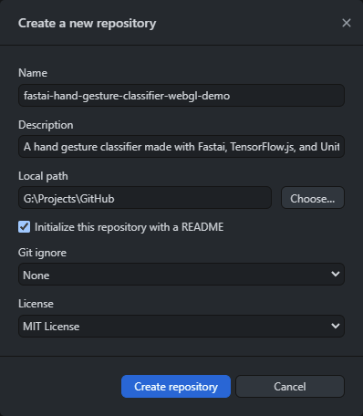
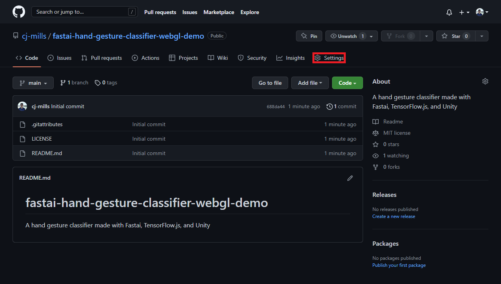
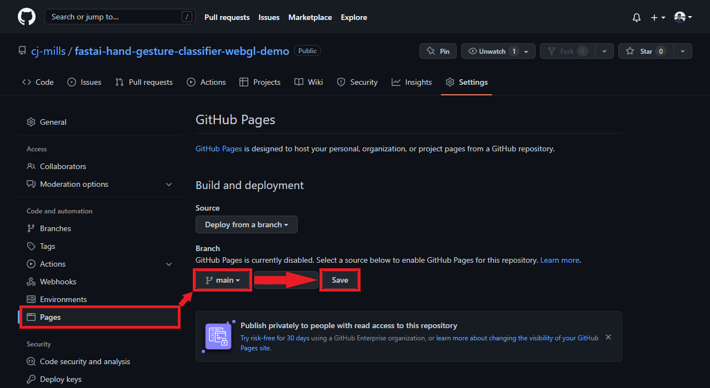
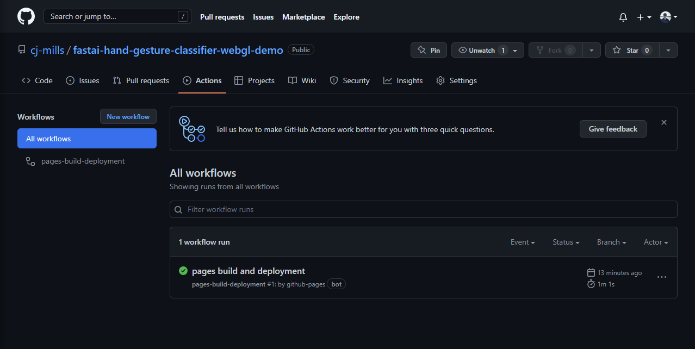
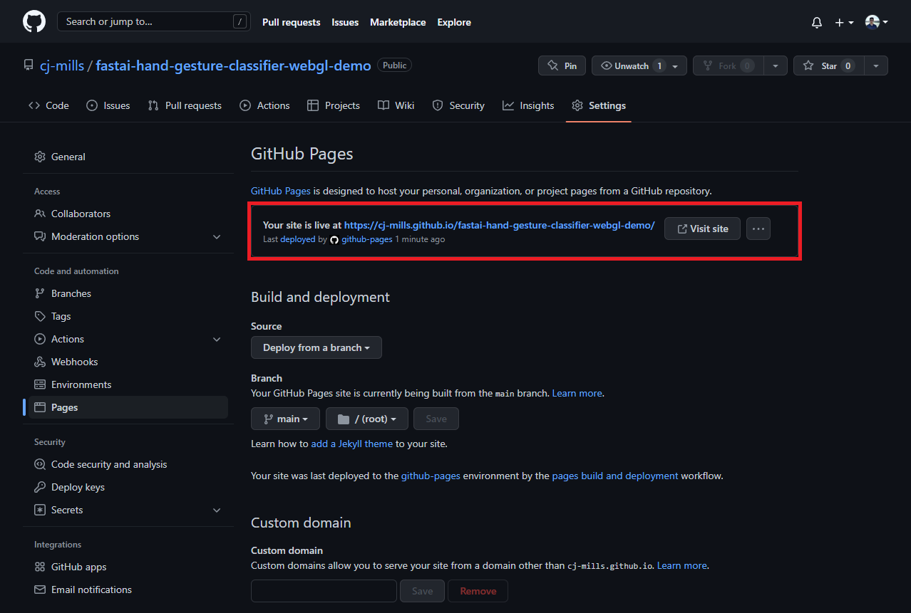
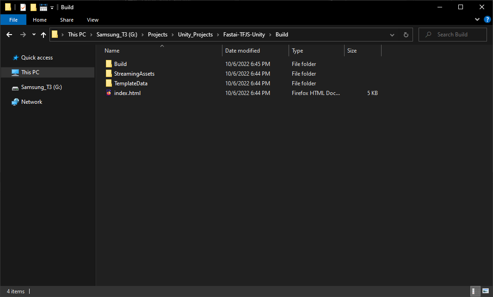
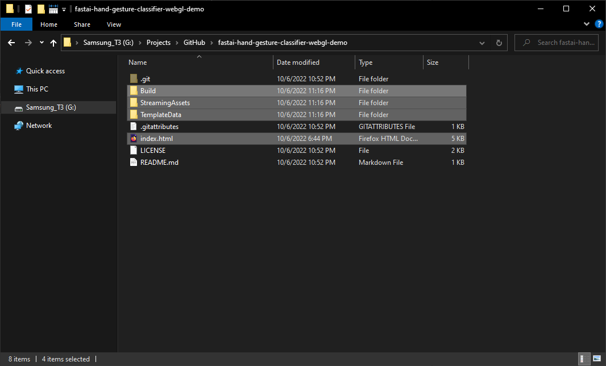
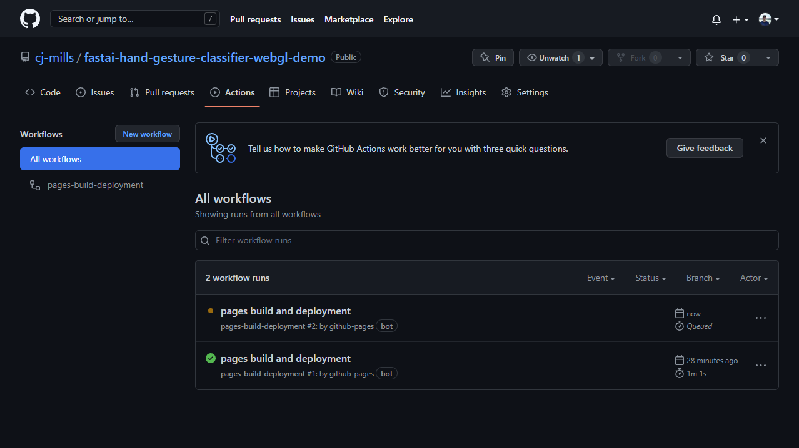
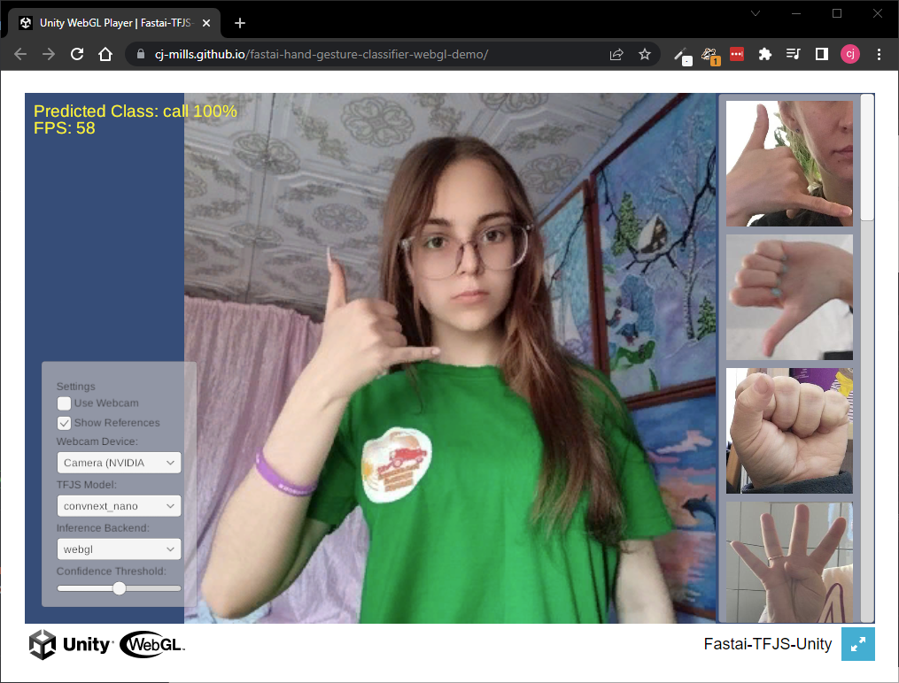

# Using Fastai and TensorFlow.js for Hand Gesture Recognition in Unity Pt. 3

> [!NOTE]
> **Retired from [christianjmills.com](https://christianjmills.com) on 2026-10-09.** This post was first published on 2022-10-06 at <https://christianjmills.com/posts/tensorflow-js-unity-tutorial/part-3/>, which now redirects here. It is kept as it was written; its tools and steps may be out of date.
>
> Source: [`posts/tensorflow-js-unity-tutorial/part-3/index.md@8229e99`](https://github.com/cj-mills/christianjmills/blob/8229e991c0be7f8c78a909f0d8a2ca74390dc1e6/posts/tensorflow-js-unity-tutorial/part-3/index.md)

*Build a Unity project as a WebGL application and host it using GitHub Pages.*

- [Overview](#overview)
- [Create GitHub Pages Repository](#create-github-pages-repository)
- [Add Unity Build Files](#add-unity-build-files)
- [Test Live Demo](#test-live-demo)
- [Summary](#summary)

## Tutorial Links

- [Part 1](../part-1/README.md): Train a hand gesture classifier using fastai and export it to TensorFlow.js.
- [Part 2](../part-2/README.md): Create a TensorFlow.js plugin for the Unity game engine.
- [Part 3](https://christianjmills.com/posts/tensorflow-js-unity-tutorial/part-3/): Build a Unity project as a WebGL application and host it using GitHub Pages.
- [GitHub Repository](https://github.com/cj-mills/tensorflow-js-unity-tutorial)

## Overview

In Part 3 of this tutorial series, we will create a [GitHub Pages](https://pages.github.com/) repository to host our Unity project as a live demo. We will start by creating a repository and adding the Unity build files. Then, we will test the live demo to verify it works properly. By the end of this post, you will have a live demo of your hand gesture recognition system that you can share with others.

## Create GitHub Pages Repository

We first need to create a [new GitHub repository](https://github.com/new) to store the WebGL build. We can do this on GitHub or locally using Git, GitHub Desktop, or another tool.

Open the Settings tab for the new repository on GitHub.

Open the `Pages` section. Switch the source branch to `main` and click the `Save` button to start the automated build process.

We can check the GitHub Pages build progress under the Actions tab for the repository.

The web page will be accessible once the `pages build and deployment` workflow completes. Although, we don’t have any web pages at the moment.

GitHub will provide a URL for accessing the web demo in the GitHub Pages section once it finishes building.

## Add Unity Build Files

Now let’s add the WebGL build from the previous post. Open the `Build` folder from [part 2.](../part-2/README.md#test-in-browser)

Copy the folder content to the repository for the GitHub Pages demo.

We can push the local changes to GitHub, which will automatically trigger the `pages build and deployment` workflow.

## Test Live Demo

We can test the web demo at the URL provided by GitHub once the build workflow completes.

## Summary

In this tutorial series, we demonstrated how to use fastai and TensorFlow.js to create a hand gesture recognition system in Unity. In Part 1, we trained a hand gesture classifier using fastai and exported it to TensorFlow.js. In Part 2, we created a TensorFlow.js plugin for the Unity game engine. Finally, in this post, we hosted the Unity project as a live demo on GitHub Pages. With this tutorial series, you now have the tools and knowledge to use TensorFlow.js models in Unity applications.

**Previous:** [In-Browser Hand Gesture Recognition for Unity with Fastai and TensorFlow.js Pt. 2](../part-2/README.md)

**Project Resources:** [GitHub Repository](https://github.com/cj-mills/tensorflow-js-unity-tutorial)
